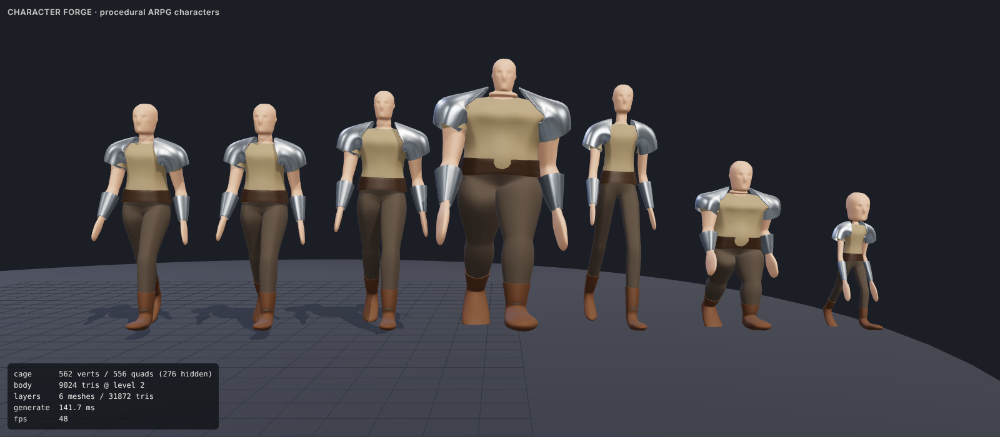
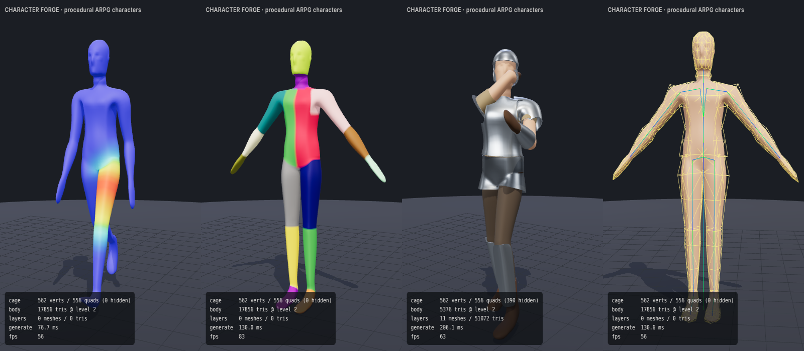

# Procedural ARPG – Character System

Prozedurales Charaktermodell-System für ein Idle/Auto-Battler-ARPG (à la Diablo 2 / Path of Exile).
TypeScript + [three.js](https://threejs.org), läuft komplett im Browser in Echtzeit.



```bash
npm install
npm run dev        # Viewer "Character Forge" auf http://localhost:5173
npm test           # Vitest (Topologie, Rig, Layer, Performance)
npm run build      # Typecheck + Produktions-Build
```

## Idee in einem Satz

Ein **Low-Poly-Skelett-Rig** erzeugt einen **Low-Poly-Kontrollkäfig** (~550 Vertices, alles Quads),
der per **Catmull-Clark-Subdivision** zu einer organischen, glatten Oberfläche wird. Kleidung und
Rüstung werden als **Schalen aus demselben Käfig** abgeleitet und verformen sich deshalb automatisch mit.

```
params ─► rig.ts ─► cage.ts ─► layers.ts ─► subdivision.ts ─► detail.ts ─► geometry.ts ─► three.js SkinnedMesh
          Skelett   Low-Poly   Kleidung/     Glättung (+       Muskeln,      Top-4 Skin-
          + Limits  Käfig +    Rüstungs-     Skin-Weights      Gesicht,      Weights,
                    Weights    Schalen       mitinterpoliert)  Noise         Index-Buffer
```

## Pipeline im Detail

| Schritt | Datei | Was passiert |
|---|---|---|
| Parameter | `src/character/params.ts` | Proportionen, Statur, Gelenke, Detailgrad, Presets (Human, Heroic, Brute, Elf, Dwarf, Goblin), seed-basierte individuelle Variation |
| Rig | `src/character/rig.ts` | 22 Knochen. Jeder Knochen hat einen Rest-Frame: lokal **X = Beugen**, **Y = Drehen**, **Z = Seitneigung**. Gelenkgrenzen sind links definiert, rechts gespiegelt und werden mit `flexibility` skaliert |
| Käfig | `src/character/cage.ts` | Torso als 4×6×2-Quad-Box, Gliedmaßen werden aus 2×2-Patches **extrudiert**: ein Ring pro Anatomie-Station, platziert auf dem Skelett. Der Kopf verdoppelt die Ringauflösung (8 → 16) für Gesichtszüge. Skin-Weights pro Ring, weich an Gelenken (`softness`) |
| Fitting | `subdivision.ts › fitCageToLimit` | Gleicht das Schrumpfen von Catmull-Clark aus, damit die glatte Oberfläche durch die entworfenen Querschnitte läuft |
| Layer | `src/character/layers.ts` | Kleidung/Rüstung deklarativ: *welche Käfigflächen* (Körperteil, Bereich, Seite, vorne/hinten). Daraus entstehen Versatz, automatisches Stapeln, Verdicken mit Rand-Crease und starre Gewichte pro Rüstungsteil. Verdeckte Körperflächen werden entfernt |
| Subdivision | `src/character/subdivision.ts` | Catmull-Clark mit N-Gons, offenen Rändern und semi-scharfen Creases (Rüstungskanten). Interpoliert **alle** Vertex-Kanäle, also auch Skin-Weights |
| Detail | `src/character/detail.ts` | Ellipsoid-Sculpts (Muskeln, Fett, Nase, Augenhöhlen, Ohren …) + fbm-Noise entlang der Normalen. Kleidung folgt dem Feld anteilig (`conform`) |
| Ausgabe | `geometry.ts`, `generator.ts` | Indizierte `BufferGeometry` mit 4 Influences, ein `SkinnedMesh` pro Layer, alle auf **einem** gemeinsamen Skelett |
| Animation | `src/character/animation.ts` | Prozedurale Test-Clips (idle, walk, attack, flexTest). Posen werden an den Gelenkgrenzen geklemmt |

## Prozedural vs. künstlerisch

- **Künstlerische Daten** liegen in `src/character/anatomy.ts`: Querschnittsprofile der Gliedmaßen (Stationen),
  Torso-Schichten und Sculpt-Formen. Zahlen ändern, neu laden, fertig. Kein Code nötig.
- **Prozedurale Regeln** skalieren und modulieren diese Daten über Proportionen, Muskulatur, Körperfett,
  Gliedmaßendicke und den Seed. Zum Beispiel werden zu dicht liegende Ringe automatisch weggelassen, etwa bei einem sehr kurzen Hals.

## Parameter (Auszug)

| Gruppe | Parameter |
|---|---|
| Proportionen | `headSize`, `neckLength`, `torsoLength`, `shoulderWidth`, `hipWidth`, `armLength`, `forearmRatio`, `legLength`, `shinRatio`, `handSize`, `footSize` |
| Statur | `muscularity`, `bodyFat`, `limbThickness` |
| Gelenke | `flexibility` (Bewegungsumfang 0.55×–1.35×), `softness` (Breite der Skin-Überblendung) |
| Oberfläche | `subdivisions` (0–3, gleichzeitig LOD), `muscleDefinition`, `facialFeatures`, `noiseAmplitude`, `noiseScale` |

## Verwendung im Spiel

```ts
import { buildCharacter, makeParams, OUTFITS, samplePose } from './src/character';

const hero = buildCharacter(
  makeParams({ seed: 42, variation: 0.6, proportions: { shoulderWidth: 1.2 }, build: { muscularity: 0.8 } }),
  { layers: OUTFITS.Knight, subdivisions: 1 },   // subdivisions = LOD
);
scene.add(hero.group);

// pro Frame:
const clamped = hero.setPose(samplePose('walk', time, hero.data.rig, hero.data.params.armRestAngle));
```

Ohne three.js-Szene (Server, Worker, Tests): `generateCharacterData(params, options)` liefert reine Arrays.

### Eigene Ausrüstung

```ts
const spikedHelm: LayerDef = {
  id: 'spikedHelm', name: 'Spiked Helm', kind: 'armor', slot: 'head', order: 13,
  cover: [{ parts: ['head'], from: 0.55 }, { parts: ['head'], from: 0.15, facing: 'back' }],
  offset: 0.016, thickness: 0.01, rimSharpness: 3, rigidity: 1, conform: 0, hidesBody: true,
  surfaceNoise: 0.002, material: { color: '#55504a', metalness: 0.8, roughness: 0.5 },
};
buildCharacter(params, { layers: ['tunic', 'trousers', spikedHelm] });
```

## Echtzeit-Budget

Gemessen mit `npm test` (Node, ein Kern):

| | Dreiecke | Generierung |
|---|---|---|
| Nackt, Stufe 1 | ~4,5k | ~14 ms |
| Nackt, Stufe 2 | ~18k | ~37 ms |
| Ritter (11 Layer), Stufe 1 (Gegner-Horden) | ~14k | ~25 ms |
| Ritter (11 Layer), Stufe 2 (Held / Nahansicht) | ~56k | ~75–105 ms |

Ein Draw-Call pro Layer, ein gemeinsames Skelett. Die Generierung passiert einmal beim Spawnen.
Für viele Gegner gleichen Typs sollte die Geometrie geteilt bzw. gecacht werden.

## Viewer „Character Forge“

- Archetypen, Würfeln, alle Parameter als Slider
- Outfits und einzelne Layer an/aus
- Animationen inkl. `flexTest` (fährt jedes Gelenk über seine Grenzen und zeigt geklemmte Gelenke an)
- Debug: Skin-Weights pro Knochen, Regionen, Wireframe, Käfig, Skelett, Archetypen-Lineup
- Export als `.glb`



## Nächste Schritte (Ideen)

- UVs / Triplanar-Shader für Texturen, Normal-Maps für feine Hautdetails
- Dual-Quaternion-Skinning für volumenerhaltende Ellbogen/Knie
- Finger und Daumen als zusätzliche Extrusionen aus dem Hand-Patch
- Lose Kleidung (Umhänge, Roben) über Cloth-Bones oder Verlet
- Geometrie-Cache und Web-Worker-Generierung für große Gegnerwellen
